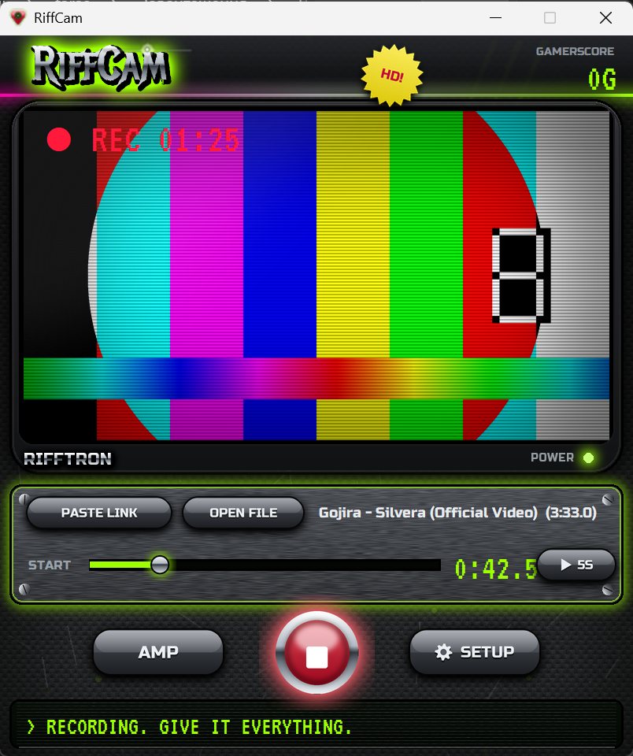

<p align="center"></p>

<h1 align="center">RiffCam</h1>

<p align="center"><b>Film yourself playing guitar along with a song. One window, one button, no editing.</b></p>

<p align="center"></p>

Recording a play-along video usually means: download the backing track, record the guitar in your DAW,
film yourself separately, then line everything up in a video editor. RiffCam does all of that for you:

1. **Paste a YouTube link** (or pick an audio file) and choose where in the song to start.
2. Hit **● REC** and play. You hear your amp plugin and the song through your audio interface, with
   your usual low latency.
3. Hit **■ STOP**, then **Keep** or **Delete** the take.
4. **Trim** it: the video plays right in the window, click the waveform to jump around, set the start and
   end, and **Export**. You get an MP4 in `Videos\RiffCam`.

## How it works

RiffCam drives two free/cheap tools you may already have:

- **REAPER** is the amp and the recorder. It plays the song and records your *dry* guitar through ASIO,
  in perfect sync with the song (REAPER compensates its own latency). Your amp sim (Neural DSP, Line 6
  Helix Native, NAM, anything) sits on a track in REAPER.
- **OBS Studio** films the webcam and *also* records the same dry guitar.

After a take, REAPER renders exactly what you heard (amp, song, faders, master FX), and RiffCam finds
where the REAPER take sits inside the OBS recording by matching the two copies of your dry guitar.
That puts the video in sync with the sound to the millisecond, with no clapping or manual nudging.

## Requirements

- Windows 10 or 11
- [REAPER](https://www.reaper.fm) (the free evaluation works)
- [OBS Studio](https://obsproject.com) 30 or newer
- An audio interface with an ASIO driver, a webcam, and an amp plugin for REAPER

## Install

1. Download `RiffCam-windows.zip` from [Releases](../../releases) and unzip it anywhere.
2. Run `RiffCam.exe`.

There's nothing else to install: FFmpeg, yt-dlp and everything else ship inside the zip.

## First run

1. **RiffCam setup** opens: pick your **camera** and the **input your guitar is plugged into**
   (for example `Analogue 1 + 2 (Focusrite USB Audio)`). RiffCam creates its own OBS profile and scene
   for this; your other OBS settings stay as they are.
2. **In REAPER**, once:
   - *Options > Preferences > Audio > Device*: choose your interface's **ASIO** driver.
   - On the **Guitar** track (it's armed for recording), choose your guitar's input and add your amp
     plugin with the **FX** button. The **🎛 Amp** button in RiffCam opens it too.

Change the camera or input later with the **⚙** button.

## Tips

- **Song levels:** the song plays on REAPER's **Backing** track. Set its fader and your guitar track's
  fader in REAPER; the video gets exactly that mix.
- **Start a bit early.** Set *Start at* a few seconds before the part you want, and trim later.
- **Picture lags the sound?** Webcams are often a little late. Raise *Video delay* in **⚙** setup
  (try 50 to 150 ms).
- **Files:** finished videos go to `Videos\RiffCam`. The raw camera recording and your dry guitar stay in
  `Videos\RiffCam\raw`, so a take can be re-amped later.

## Troubleshooting

- **"REAPER didn't start recording"**: REAPER's evaluation reminder (or another dialog) is open in
  REAPER. Close it and press REC again. Also check that a track is armed.
- **OBS shows an "update available" window** at start: choose *Remind me later* or update OBS.
- **A YouTube link stops working**: YouTube changes often. Grab the latest RiffCam release (it ships a
  newer yt-dlp), or use **📂 File**.
- **Settings and the REAPER project** live in `%APPDATA%\RiffCam`. Delete `settings.json` to run setup
  again.

## Run from source

```powershell
python -m venv .venv
.venv\Scripts\pip install -r requirements.txt
.venv\Scripts\python riffcam.py          # the app
.venv\Scripts\python riffcam.py --test   # self-test (needs REAPER installed)
.\build.ps1                              # builds dist\RiffCam-windows.zip
```

## License

MIT, see [LICENSE](LICENSE). The release zip bundles third-party programs under their own licenses,
listed in [THIRD_PARTY_NOTICES.md](THIRD_PARTY_NOTICES.md).
